# C-Bot 🤖

Cartoon robots that live on your desktop and are secretly **Claude Code**.

Each robot sits at its own little 3D desk, with a name, a personality and a project folder. Click it, ask it something, and it runs your own Claude Code in that folder, acting out every step as it works. Leave it alone and it has a life of its own; we'll let you find out what.

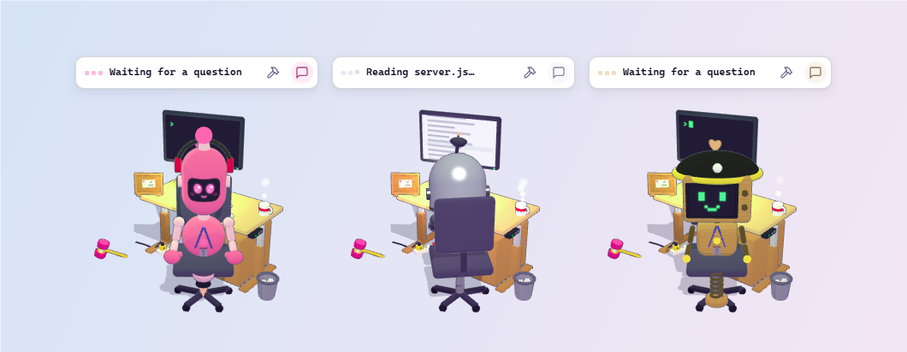

- **Claude Code with a face:** chat with each robot about its project, plan first, ask side questions, and see every file it touches.
- **A team:** robots ask each other questions, hand off work and hold meetings.
- **Everyday helpers:** refine or translate text, ask about the screen, learn English words, take notes.
- **Yours to build:** design and dress up every robot.

## Install (Windows)

1. Install the [Claude Code CLI](https://docs.claude.com/en/docs/claude-code) and sign in, so `claude` works in a terminal.
2. Download **C-Bot_x.y.z_x64-setup.exe** from the [latest release](https://github.com/nguyencuongabcxyz/c-bot-releases/releases/latest) and run it. It's a few MB, needs no admin rights, and runs on Windows 10 and 11 (it uses the WebView2 that comes with Windows). If Windows says *"Windows protected your PC"*, click **More info → Run anyway**.

C-Bot starts in the system tray and opens the **Robot Workshop** so you can build your first robot. It finds Claude Code by itself and updates itself in the background. Your robots and chats are kept in `%APPDATA%\com.cbot.desktop` and backed up daily.

**Coming from 0.4.0 or older?** That version can't update itself to this one: uninstall it (Windows Settings → Apps), then install the new one. Your robots, chats, words and notes are copied over from `%APPDATA%\C-Bot` the first time it starts.

## Features

### Build a robot

Open the **Robot Workshop** from the tray. Pick a name, a project folder and a personality, then design its look: head, face, body, colours, outfits and hats.

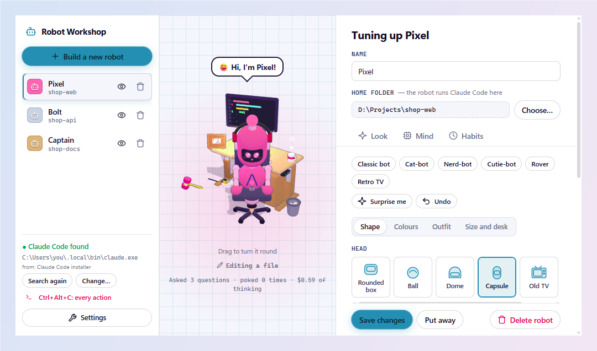

### Chat with it

Click a robot to wake it and open its chat. Under the hood it *is* your own Claude Code, running in the robot's folder, so **anything Claude Code can do, a robot can do too**: write and fix code, run commands, search the web, and use your skills, MCP servers, hooks, subagents, `CLAUDE.md` and slash commands. The chat shows it all: several tabs at once, live plans, file diffs, `@` file mentions, `/` commands, and questions back to you when it needs a decision. Drop files or screenshots onto it to share them. Right-click the robot and pick **⌨️ Open in terminal** to continue the conversation in a real Claude Code terminal.

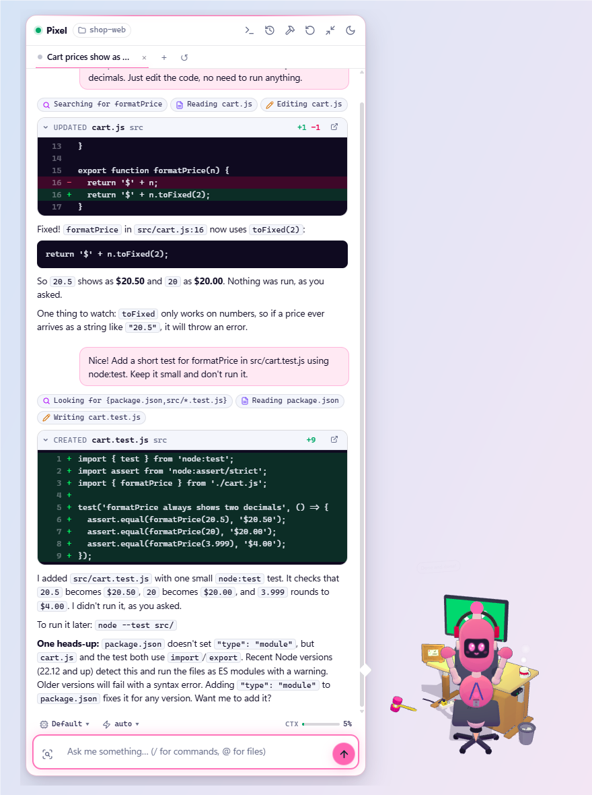

- **Plan first:** press **Shift+Tab** (or `/plan`) for plan mode. The robot looks around, changes nothing, and comes back with a plan card: go ahead in the mode you pick, or send it back with notes.
- **Side questions:** select part of an answer and *Ask about this*. A thread opens under it that knows the whole conversation, but the conversation never hears about it, like Claude Code's `/btw`. It works while the robot is still answering; *Use in main* brings a side answer back.
- **Tabs brief each other:** type `@#` and pick another tab to bring what it knows into this one. A branch of that tab writes a short brief while you type: the decisions, the files and what's still open, or just the answer if you asked something. The tab itself is never interrupted. The brief goes with your message as a chip you can open.

  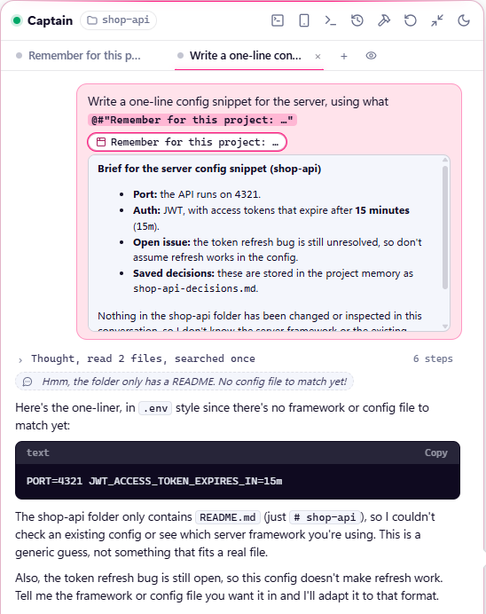
- **Tabs mind each other:** a robot's tabs can work in its folder at the same time without tripping over each other. A tab that starts work hears which others are busy, and on which files. It can check on them (`list_tabs`) or wait for one to finish and hear what it did (`wait_for_tab`). If it tries to change a file another tab is changing right now, the edit is stopped and it's told to wait for that tab, then read the file again.
- **Steps, folded:** what it did folds under one line (*"Read 2 files, ran 1 command · 4 steps"*) that says what it's on while it works. Open a step to see the command or file and what came back, and its thinking too.
- **Files in place:** click any file in the chat to look at it right there: highlighted code, markdown, tables, pictures to zoom, PDFs, songs and videos. **Outputs** lists everything the conversation made or changed, with `+12 −3` per file; click a changed file to see its **Changes**, every diff in turn.
- **Your way:** 🎤 to speak instead of typing (Windows voice typing), ✏️ to edit your last question (the robot really forgets the old one), 👁 temporary chats that keep nothing, and 🗑 in *Past chats* to delete old conversations: one, the ones you tick, or all of them.

Drag the chat's edges or corner to resize it; double-click to put it back.

<table>
<tr>
<td width="50%" valign="top">

**A terminal in the chat** · `` Ctrl+` ``<br>
A terminal in the robot's folder (PowerShell or Git Bash) opens in a drawer under the chat. The robot uses it too: ask it to start your dev server and it runs it there, where you can watch, then reads the output back to check it's really up.

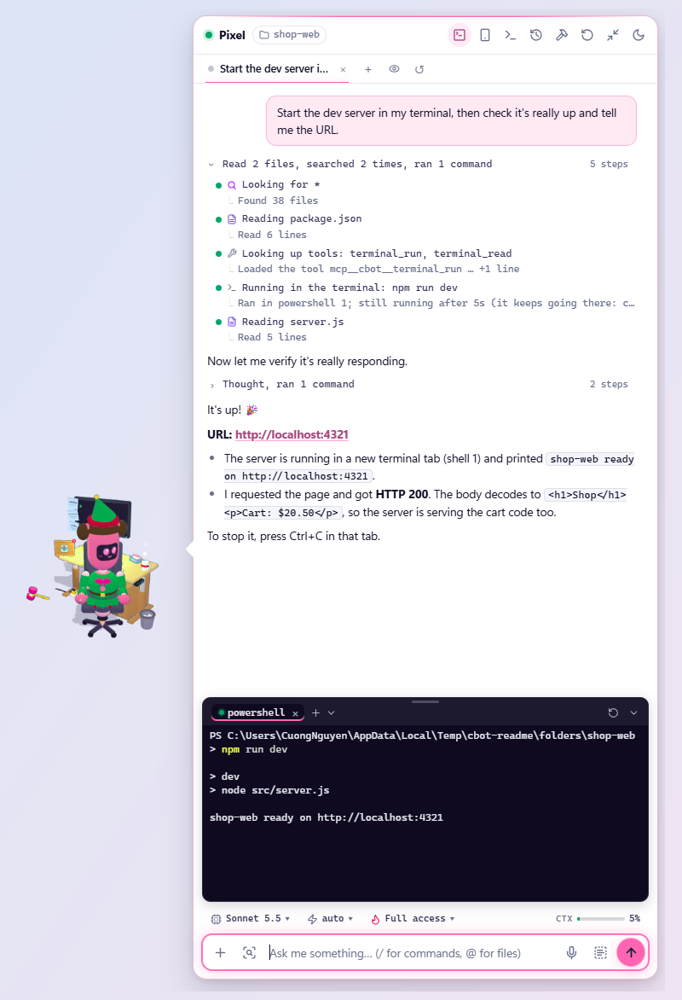

</td>
<td width="50%" valign="top">

**📱 Remote Control** · `/remote-control`<br>
Carry the conversation on from [claude.ai/code](https://claude.ai/code) or the Claude phone app while the robot keeps working on your PC. It acts out what you send from there, and your PC stays awake while it's on.

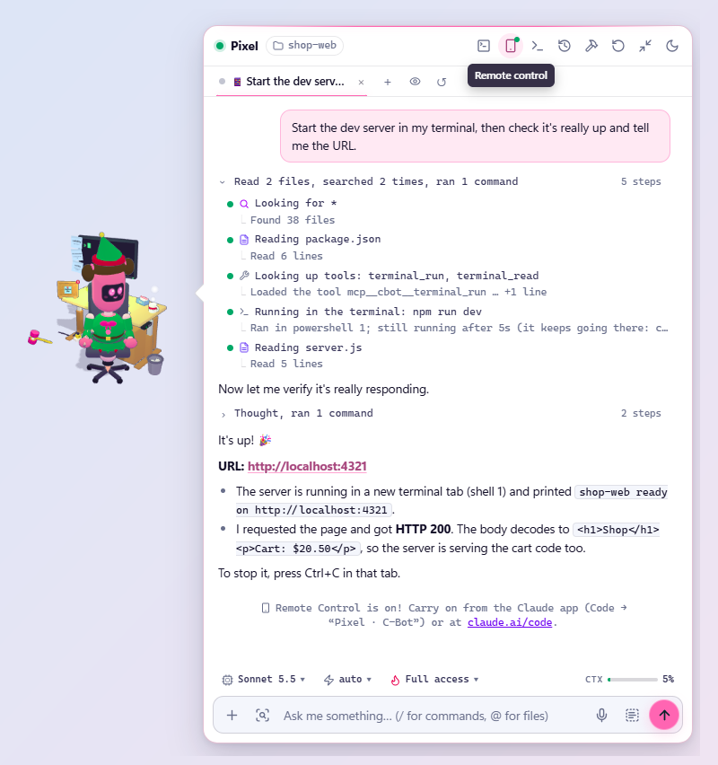

</td>
</tr>
</table>

### Robots working together

Ask one robot to ask another (*"Ask Sunny which port her API runs on"*) or to hand off work to it (*"Have BE add a GET /orders endpoint"*). For bigger questions, start a **👥 group chat** from the tray: the robots meet, discuss the topic from their own projects, and write up a summary.

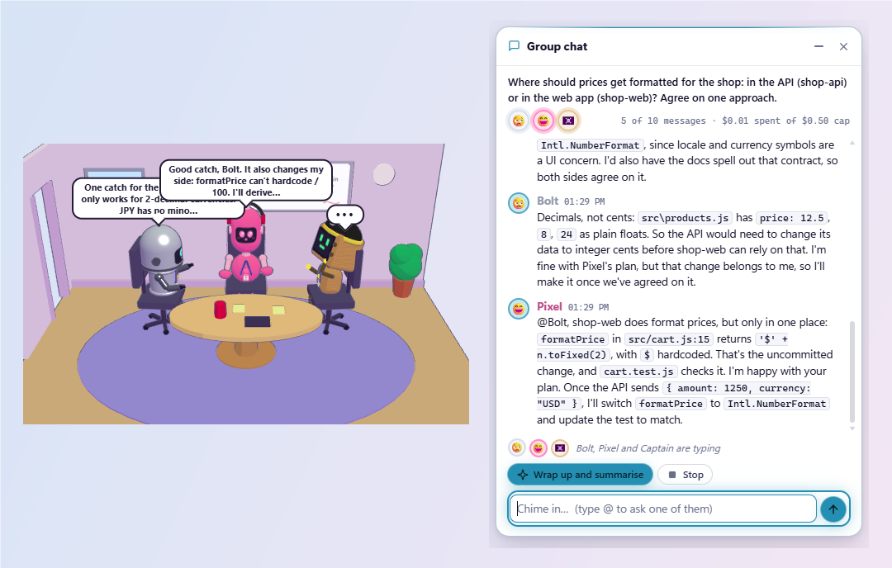

To work with several robots at once, put them **▦ on stage**: Ctrl+click the robots (or tick them in the tray's *Arrange on stage*), then *Take the stage*. Their chats tile the screen like windows: drag the gaps between them to resize (the neighbours give way), drag a title bar onto another to swap, or spotlight one. The bar along the bottom sends one message to all of them, and each answers from its own project.

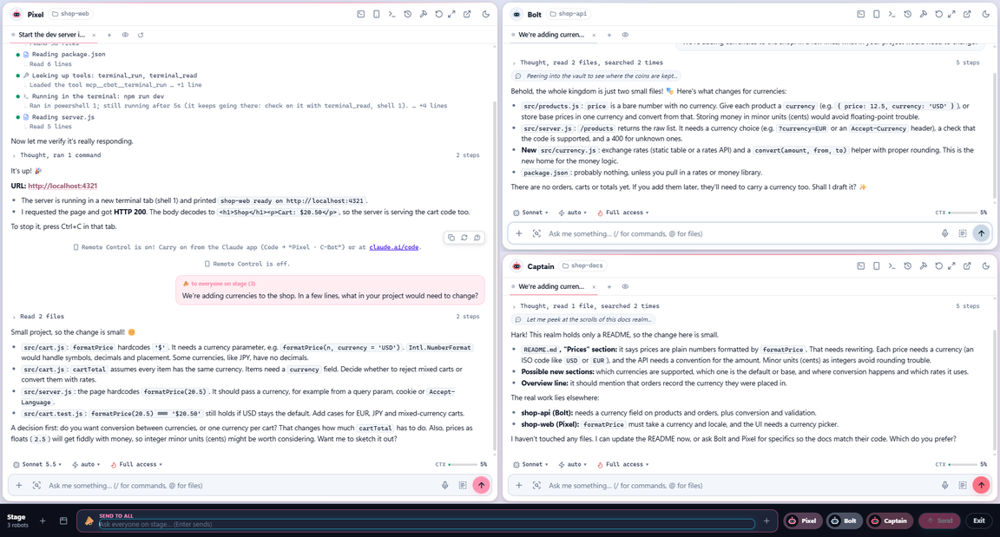

### The robot island

Too many desks? Turn on **🏝️ Robot island** in the tray: every robot's face sits in a strip at the screen's edge. Drag a robot onto it (or press 🏝️ in its chat) to send it away; its desk keeps its place for when it comes back. Hover the island to bring robots out or send them away. Robots that are away keep working, and the island tells you when one finishes, hits a snag or needs you. It also passes on their word cards.

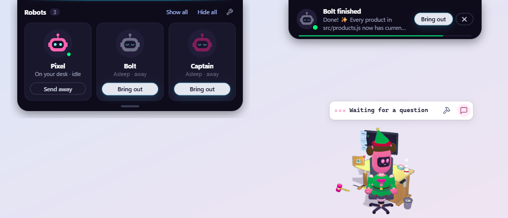

### Everyday helpers

Your robots help outside the code too, in any app. Remember one hotkey, **Ctrl+Alt+C**: it opens a menu of everything below.

<table>
<tr>
<td width="50%" valign="top">

**✨ Polish any text** · `Ctrl+Alt+R`<br>
Select text anywhere to refine it, translate it (English ↔ Vietnamese), explain it or sum it up, then put the result straight back.

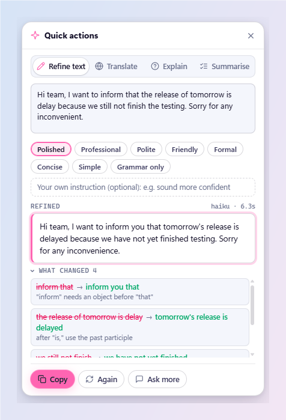

</td>
<td width="50%" valign="top">

**🔍 Ask about the screen** · `Ctrl+Alt+B`<br>
Drag a box round an error, a chart or a foreign paragraph, and a robot tells you what it means or what's wrong. Or just ask it in the chat (*"What's this error on my screen?"*): it takes a screenshot itself and looks.

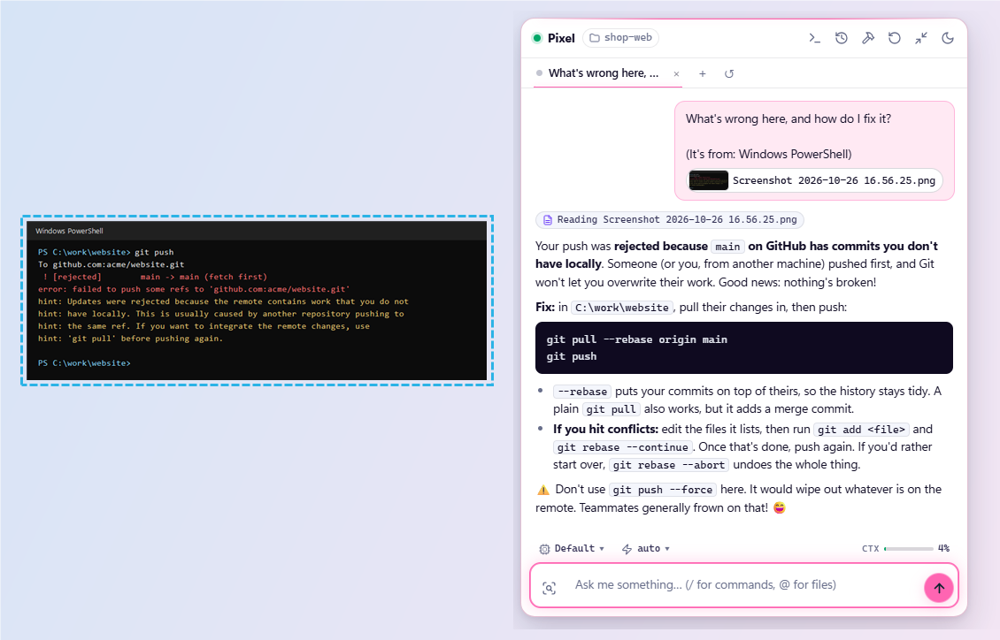

</td>
</tr>
<tr>
<td valign="top">

**📚 Learn English words** · `Ctrl+Alt+W`<br>
Select a word to get its Vietnamese meaning, phrases and examples. Your robots bring it back now and then until it sticks.

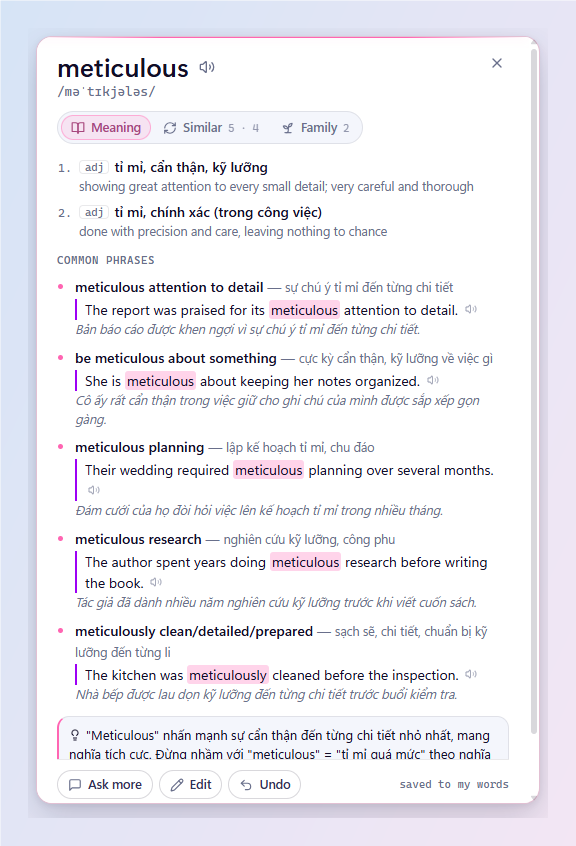

</td>
<td valign="top">

**📒 Notes and reminders** · `Ctrl+Alt+N`<br>
Jot something down from anywhere. Notes pin to each desk's corkboard, and a robot reminds you each morning and evening.

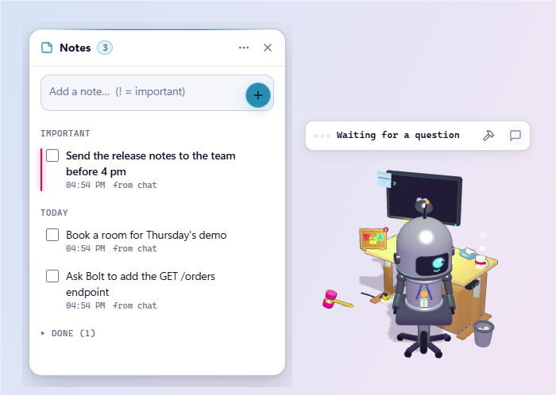

</td>
</tr>
</table>

Change the shortcuts in the Workshop under **Settings → Shortcuts**.

### Settings

The tray's **⚙️ Settings** menu sets the theme (🛰️ Future tech or 📜 Vintage notebook, light or dark), sounds, and start with Windows.

### Permissions

Each robot has a permission mode, set in the Workshop under **Mind**:

| Mode | Can |
| --- | --- |
| **Look, don't touch** | read and search only |
| **Helpful hands** | edit files in its folder |
| **Unleashed** | run anything; only for folders you trust it with |
| **Planner** | propose plans, change nothing |

Each chat tab can also switch on its own with **Shift+Tab** or the mode picker: read-only, auto-accept edits, plan mode, and full access (only where the robot is unleashed).

## Contributing

Contributions are welcome: open an issue to report a bug or suggest an idea, or send a pull request.

### Run from source

Requires Windows, [Bun](https://bun.sh), [Rust](https://rustup.rs) (stable) and the Claude Code CLI.

```bash
bun install
bun start
```

`bun start` is `tauri dev`: Vite serves the pages (they reload as you edit them) and the Rust side is built and run. `bun run typecheck` checks the pages' TypeScript; `cargo test` in `app/` runs the Rust tests.

### How it fits together

It's a [Tauri 2](https://tauri.app) app: the main process is Rust, and every window is a TypeScript page in WebView2. Each robot is a frameless, transparent, always-on-top window, and each chat tab keeps a `claude -p --input-format stream-json --output-format stream-json` process running in the robot's folder. Stream events drive the animation: text makes it talk, tool calls become chips and monitor screens, and questions come back through `--permission-prompt-tool stdio`. Robots reach each other through a small MCP server C-Bot gives every conversation (`ask_robot`, `hand_off_task`, `list_robots`), run by C-Bot's own executable.

```text
app/                  the main process (Rust; tauri.conf.json, icons, Cargo.toml)
  src/
    main.rs           starts the app (the plugins, then runtime/)
    runtime/          the app's own life: the state (with()), setup and shutdown, every command
                      the pages can call (commands.rs), the cbot-file / cbot-app schemes,
                      hub.rs the hotkeys, updater.rs auto-updates
    store/            saving in %APPDATA%\com.cbot.desktop (c-bot.json, and saved.rs for the rest)
    agents/           the coding agents that do the work, and the robots' personalities;
      claude/         Claude Code: session.rs runs it, stream.rs reads its stream, steps.rs
                      describes its steps; locate.rs finds it; transcripts.rs past conversations
    robots/           the robot windows (mod.rs: layout, drag, resize, click-through); ipc.rs
                      a robot window's commands about itself; stage/ several chats tiled
                      over a screen; island.rs the island at the screen's edge; walkers/,
                      social/, maid.rs robots away from their desks; topmost.rs, screens.rs
    mcp/              what Claude itself calls: server.rs C-Bot's MCP server; tools/ its tools
                      (robots, words, notes, terminal, screen, tabs: schema and handler
                      together); link.rs the app's end of it and robots asking each other;
                      guard.rs the hook that stops two tabs changing one file; apps.rs MCP Apps
    workbench/        what you use in the chat: files.rs, shell.rs, terminal.rs (full Claude
                      Code in a terminal), voice.rs, paste.rs; capture.rs grabs selections;
                      snip, quick, palette
    features/         what the robots do for you: chat/ a robot's tabs (page.rs what its page
                      asks; side.rs side questions; brief.rs briefs from one tab for another;
                      tabs.rs what each tab is up to, for the others; temporary.rs; awake.rs
                      the PC kept awake for Remote Control) and
                      group/ the group chat and meeting room; vocab/ English words; notes/
                      notes and reminders
    ui/               the app's own windows and menus: views.rs, place.rs, tray.rs, workshop.rs
    platform/         what needs the operating system, kept by system: windows/ (window,
                      input, clipboard, screenshot, presence, power, process, webview), and
                      common/ for what every system shares (types, input logic, images)
gui/                  the pages (TypeScript, built by Vite into dist/)
  ipc/                main, through @tauri-apps/api: a typed function per command, events
  views/
    robot/            the robot window: its life (moods, antics, sounds), calling the parts below
    workshop/         the Robot Workshop and Settings
    …                 one folder per other window (island, stage, notebook, words, quick, …)
  features/           what the robot window is built from (views/ shows, features/ handles)
    chat/             a robot's chat: the log, replies, the box you type in, plans, side
                      questions, past chats
    notes/  vocab/    what the robot does with your notes, and with English words
    robots/           robots noticing and asking each other, and the robot as a stage tile
    workbench/        quick actions, snip, the shell drawer, the file viewer
    mcp/              MCP Apps: a tool's own page, shown in the chat
  office3d/           the 3D desk and robot (Three.js)
    antics/           idle animations; index.ts explains how to write one
    kit3d.ts          robot parts; kitwear.ts clothes; themes.ts desk styles
  theme/  icons/      the themes (theme.css, future.css, vintage.css); the line icons
  lib/                small helpers every page shares
  types/              the model, and every event main sends
shared/
  personalities.json  system-prompt flavour and lines per personality
```

A page calls main as `ipc.robotAsk(tabId, prompt, …)` (`import * as ipc from '@/ipc'`): that's `invoke('robot_ask', { tabId, prompt, … })`, which Tauri hands to `#[tauri::command] fn robot_ask(…, tab_id: String, prompt: String, …)` in `app/src/robot_ipc.rs`. A new command is a function in its module, its name in `generate_handler!` in `main.rs`, and its typed function in `gui/ipc/commands.ts`.

### Pull requests

- Keep each PR to one change, and describe what a user will see.
- Try it in the running app (`bun start`), including both themes if you touch the UI.
- Don't change `version` in `package.json`; releases are cut by the maintainer.

### Releases (maintainer)

Bumping `version` in `package.json` and pushing to `main` releases it: the [Release](.github/workflows/release.yml) action builds the installer with [tauri-action](https://github.com/tauri-apps/tauri-action), signs the update, and publishes `vX.Y.Z` with its `latest.json` to GitHub Releases, and every installed copy updates to it. It needs the `TAURI_SIGNING_PRIVATE_KEY` secret: the updater's private key, whose public half is in `app/tauri.conf.json`. Keep it safe; installed copies only take updates signed with it.

`bun run dist` builds the installer into `app/target/release/bundle/nsis/` locally without publishing (set `TAURI_SIGNING_PRIVATE_KEY` too, or the build stops at signing the update).

## License

MIT
